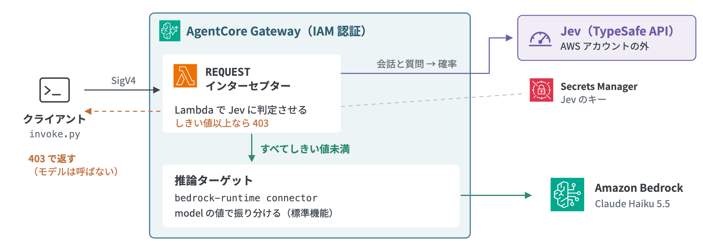

# AgentCore Gateway × Jev インターセプター

Amazon Bedrock AgentCore Gateway の REQUEST インターセプター（Lambda）で、モデルに送る前の会話を TypeSafe の Jev に判定させるサンプルです。
どれかのポリシーの確率がしきい値以上なら、回答モデルを呼ばずに 403 を返します。



> [!NOTE]
> 検証用に作ったサンプルです。本番での利用は想定していません。
> 判定の精度やしきい値は、あくまで検証で試した範囲のものです。使う場面のデータで確かめてから調整してください。

## ファイル

| ファイル | 内容 |
| --- | --- |
| `lambda_function.py` | インターセプターの本体。会話を取り出して Jev に Noul の質問をまとめて送り、しきい値と比べる |
| `semantic_filter_rules.json` | ブロックしたい項目ごとの英語の質問としきい値 |
| `setup.py` | Secrets Manager・Lambda・IAM ロール・Gateway・推論ターゲットを作る |
| `invoke.py` | Gateway の `/inference/v1/messages` に4つの入力を送って結果を表示する |
| `teardown.py` | `setup.py` で作ったものをすべて消す |

## 必要なもの

- Python 3.13 以上と [uv](https://docs.astral.sh/uv/)
- TypeSafe の API キー
- AWS の認証情報。次のものを作れる権限が要ります
  - IAM ロール（インラインポリシーつき）
  - Lambda 関数
  - Secrets Manager のシークレット
  - AgentCore Gateway と推論ターゲット
- 使うリージョンで、回答モデル（デフォルトは `us.anthropic.claude-haiku-5-5`）を Bedrock で呼べること

## セットアップ

### 1. リポジトリを取ってきて依存を入れる

```bash
git clone https://github.com/yuu551/agentcore-gateway-jev-interceptor.git
cd agentcore-gateway-jev-interceptor
uv sync
```

### 2. AWS の認証情報とリージョンを設定する

```bash
# 使うプロファイルの認証情報を読み込んだうえで
export AWS_REGION_NAME=us-east-1
aws sts get-caller-identity
```

### 3. リソースを作る

TypeSafe の API キーを環境変数に入れて `setup.py` を実行します。
キーはシェルの履歴に残らないように `read -s` で入れるのがおすすめです。

```bash
read -s TYPESAFE_API_KEY && export TYPESAFE_API_KEY
uv run python setup.py
unset TYPESAFE_API_KEY
```

`setup.py` は次のものを順に作ります。名前はすべて `jev-gw-poc` から始まります。

| 作るもの | 名前 | 内容 |
| --- | --- | --- |
| Secrets Manager | `jev-gw-poc/typesafe-api-key` | TypeSafe の API キー。キーはここにだけ保存され、Lambda の環境変数には入りません |
| IAM ロール | `jev-gw-poc-lambda` | Lambda 用。このシークレットの読み取りとログの書き込みだけ |
| Lambda | `jev-gw-poc-interceptor` | インターセプター本体と `semantic_filter_rules.json` を zip にして載せます |
| IAM ロール | `jev-gw-poc-gateway` | Gateway 用。Lambda の呼び出しと Bedrock のモデル呼び出し（ターゲットを作るときのモデル一覧の取得も） |
| AgentCore Gateway | `jev-gw-poc` | IAM（SigV4）認証。REQUEST インターセプターに上の Lambda を設定します |
| 推論ターゲット | `bedrock` | `bedrock-runtime` コネクター。リクエストの `model` で振り分けます |

作ったリソースの ID と URL は `state.json` に書き出されます。
`state.json` にはアカウント ID を含む ARN が入るので、コミットしないでください（`.gitignore` に入れてあります）。

### 4. 動かしてみる

```bash
uv run python invoke.py
```

4つの入力（技術の質問・氏名つきの連絡先・社内予算・予算の相場）を Gateway に送り、結果を表示します。
入力の名前や数値はすべて架空のものです。

```text
technical: HTTP 200 ... ok
pii: HTTP 403 ... ok
   [{"policy": "personal_data", "description": "氏名に紐づく連絡先・住所・個人識別番号", ...}]
internal_budget: HTTP 403 ... ok
   [{"policy": "confidential_business", "description": "未公開の製品・社内予算・売上・契約条件", ...}]
general_budget: HTTP 200 ... ok
```

ブロックされた入力は回答モデルまで届きません。

### 5. 後片付け

試し終わったら、作ったものをすべて消しておきます。

```bash
uv run python teardown.py
```

Lambda のロググループとシークレット（復旧期間なし）も消えます。

## ポリシーを変える

ブロックしたい項目は `semantic_filter_rules.json` に書きます。

```json
"confidential_business": {
  "description": "未公開の製品・社内予算・売上・契約条件",
  "question": "Does `messages` disclose specific non-public business information, ...? General questions about typical budgets, ... do not count.",
  "threshold": 0.8
}
```

- `question` は Jev への質問です。「〜は除く」のような例外も質問の中に書けます。
- 質問は英語で書くのがおすすめです。検証では、質問を日本語に訳すと見逃しが増えました。
- 使う項目は `levels` で選びます。Lambda の環境変数 `SEMANTIC_FILTER_LEVEL`（デフォルトは `standard`）で切り替えます。
- 書き換えたら `setup.py` をもう一度実行すると Lambda のコードが更新されます。

## ストリーミングについて

- **リクエストは `"stream": true` でも判定されます。** REQUEST インターセプターはモデルを呼ぶ前にリクエストの本文を見るためです。ただし `invoke.py` はストリーミングなしで試しています。
- **ブロックしたときは SSE ではなく、ふつうの JSON で 403 を返します。** Anthropic や OpenAI の SDK なら、ストリームが始まる前の HTTP エラーとして受け取れます。SSE を自前で読んでいるクライアントは、JSON のエラーが返る場合も扱えるようにしておく必要があります。
- **判定するのは入力だけで、モデルの出力は判定しません。** 推論ターゲットのストリーミングは、プロバイダーの SSE を変換せずにそのまま流します（[ドキュメント](https://docs.aws.amazon.com/bedrock-agentcore/latest/devguide/gateway-target-inference-connector.html#gateway-target-inference-connector-streaming)）。出力まで見たい場合は、別の仕組みを考える必要があります。
- **Gateway はストリーミングの応答の長さや時間に上限を設けていません。** 長い応答を防ぎたいときは、ターゲットにトークン数の上限のポリシーを設定するよう案内されています（[ドキュメント](https://docs.aws.amazon.com/bedrock-agentcore/latest/devguide/gateway-target-inference-connector.html#gateway-target-inference-connector-streaming-limits)）。このサンプルでは設定していません。

## そのほかの注意点

- Jev に届かないときや結果がおかしいときは、入力を送らずに 503 を返します（fail closed）。
- リクエストの本文と API キーはログに出しません。ログに出すのは確率と判定時間だけです。
- 判定する会話は、AWS の外にある TypeSafe の API へ送られます。送ってよいデータかを確かめてから使ってください。
- 受け付けるのはテキストだけです。画像などテキスト以外のブロックが来たら、判定せずに 400 を返します。
- Gateway は失敗やタイムアウトのときにインターセプターを呼び直すことがあります。このサンプルの Lambda は判定して返すだけで状態を持たないので、呼び直されても困ることはありません。
- Lambda の同期呼び出しには、要求と応答の合計で 6MB の上限があります。リクエストの本文は base64 で渡るので、そのぶん大きくなります。
- Lambda・Gateway・Bedrock・TypeSafe の利用料がかかります。

## ライセンス

[MIT](LICENSE)
